https://github.com/user-attachments/assets/567075ea-37c7-4308-ba49-19b343440e81

<p align="center"><sub><b>The 1:39 demo</b>: the island, the local model writing your timesheet, review, and the bill. Sound on. Also on <a href="https://youtu.be/2iFeEuZe4xc">YouTube</a>.<br><b><a href="https://lowkey.nirajlabs.tech">Try it live at lowkey.nirajlabs.tech</a></b>: the real dashboard, running in your browser on a demo week.</sub></p>

<p align="center">
  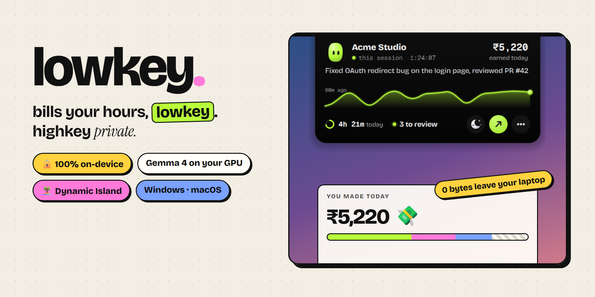
</p>

<p align="center">
  <b>A Dynamic Island for your laptop that writes your timesheet.</b><br>
  It watches what you work on, lets an open model running <i>on your own GPU</i> turn it into invoice-ready lines,<br>
  and never sends a byte of your screen activity anywhere.
</p>

<p align="center">
  
  
  
  
  
</p>

<p align="center">
  <a href="https://youtu.be/2iFeEuZe4xc">Demo video</a> ·
  <a href="#-quick-start">Quick start</a> ·
  <a href="#-what-you-get">What you get</a> ·
  <a href="#-how-it-works">How it works</a> ·
  <a href="#-privacy">Privacy</a> ·
  <a href="docs/configuration.md">Configuration</a> ·
  <a href="docs/troubleshooting.md">Troubleshooting</a>
</p>

---

## Why

If you bill by the hour, your timesheet is a guess. You forget to start the timer, you jump between three clients before lunch, and at the end of the month you rebuild the week from browser history.

The tools that fix this want either **your money** (subscriptions that keep going up) or **your screen** (they watch everything you do and send it to their cloud). Your screen is your clients' code, your DMs and your bank tab.

**lowkey** does the watching *on your laptop*, with an open-weight model you run yourself. Nothing to sign up for, nothing to upload, nothing to cancel.

## ⚡ Quick start

**1. Install [Ollama](https://ollama.com) and pull the model** (≈4.6 GB, runs on a 6 GB laptop GPU):

```bash
ollama pull gemma4:e2b
```

**2. Get lowkey** (Python 3.10+):

```bash
git clone https://github.com/nirajkhetre/lowkey.git
cd lowkey
pip install -r requirements.txt   # only needed for the island; the rest is standard library
```

**3. Try the demo week first** (tracks nothing):

```bash
python -m lowkey --demo
```

Open **http://127.0.0.1:7777**.

**4. Add your clients and start tracking:**

```bash
python -m lowkey
```

The first run creates `clients.json` from [`clients.example.json`](clients.example.json). Put your real clients in it, then restart. Each client gets a name, hourly rate, colour and a few **hints**: repo names, domains, project names, anything that shows up in your window titles. See [Configuration](docs/configuration.md).

> **macOS:** allow your terminal under *System Settings → Privacy & Security → Accessibility* so lowkey can read window titles.

## ✨ What you get

### 🏝️ The island

A notch tucked into the edge of your screen, glowing in your current client's colour.

<p align="center">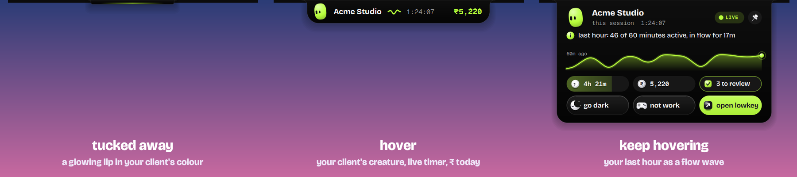</p>

- **Hover** and it springs out into a pill: your client's creature, a tiny live squiggle, the session timer and money earned today.
- **Keep hovering, or click,** and it opens:
  - what the model thinks you're doing, typed in live
  - a **flow wave** of your last hour: it ripples while you work, goes still and moonlit when you're off the record, and on hover tells you how many of the last 60 minutes were active and how long you've been in flow
  - today's money in the corner, today's time as a little activity ring, and how many sessions wait for review
  - three round buttons and nothing else: **go dark** (pause tracking: the island turns into a night sky, off the record), **open lowkey** (the one filled, primary action) and **•••**
- **Built like a Live Activity:** the buttons have no labels, because hovering any of them explains it in the line under the client name. The rarer actions wait behind **•••**: not work (with 5 s to undo), pin and settings.
- **Pin** (or double-click) keeps it out. It never takes keyboard focus, so it can't interrupt your typing.
- **Fullscreen video or game? It steps aside**, the way the menu bar does on a Mac: no lip, no shadow, no pop-outs or nudges over your movie. Rest the cursor at the very top of the screen and it slides out from the real edge (Windows; on macOS fullscreen apps get their own Space anyway).
- **Settings** open right inside the island. Hover an option and a little screen pops out beside it, acting out exactly where the island will go; click and it moves there for real, then waits open for you.

<p align="center">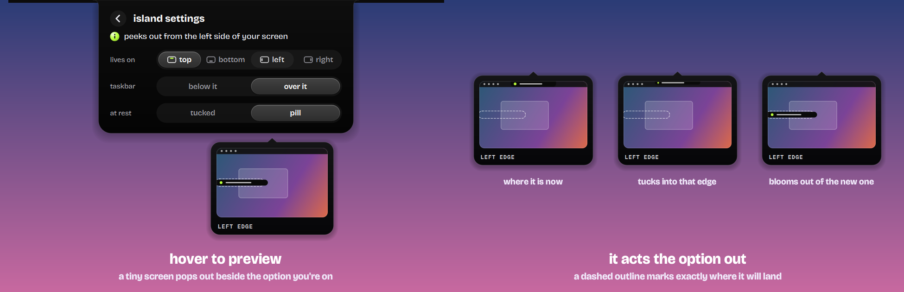</p>

<p align="center">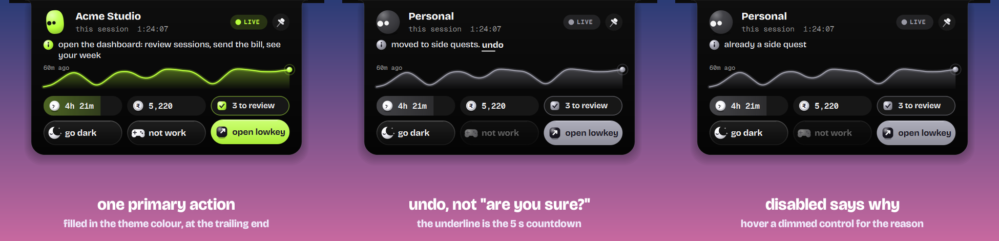</p>

<p align="center">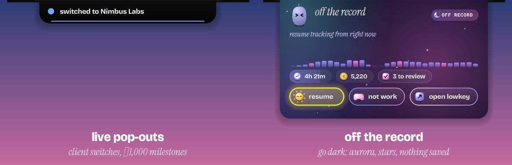</p>

#### Meet your creatures

Every client gets its own little blob: a shape picked from the client's name, in the client's colour. When you switch clients, it **morphs** into the next one.
- **Its eyes follow your cursor,** with a bit of perspective, so it looks like it turns its head.
- **It blinks on its own,** and sometimes double-blinks.
- **It breathes,** squash-wobbles when its mood changes, and falls asleep when you walk away.
- **Its mood follows what you're actually doing.**
- **Click it** and it tells you something useful about your day: time on the current client, money secured, progress to your daily goal, sessions waiting for review.

<p align="center">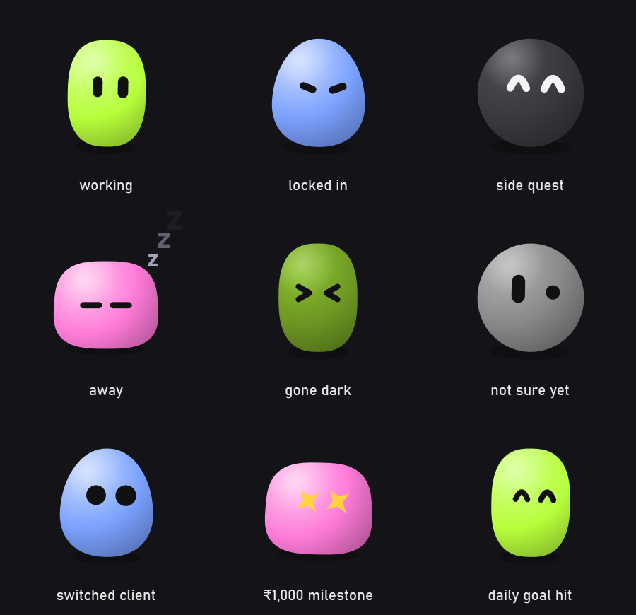</p>

### 🎯 Intentions

When nothing's on, the top of the dashboard just asks: **what are you working on?** Answer in your own words, *"acme login fix by 5, about an hour"*. lowkey reads it as you type (client, deadline and length pop in as chips, and the ring takes the client's colour and your estimate; plain parsing, so it's predictable). `Enter` starts it, `Shift+Enter` lines it up for later. While something is on, **then…** at the end of the next-up line opens in place for what comes after. It's not a to-do list: there's one thing now, and lowkey holds you to it, gently.

- **It knows when you've drifted, because it already sees what you're on.** Your own words or your client's hints in the window: on it. Another client's window, or a known distraction (YouTube, Instagram…): drifting. Everything else (a terminal, some docs) is neutral, because research is part of the work.
- **Drifting earns a nudge, rarely.** After 8 minutes on a distraction the island peeks out: *"8 min on YouTube · back to acme login fix?"* At most three an hour, never while you're away or off the record, and an ignored nudge just counts as "later".
- **Moved on to another client? It asks how far you got.** One tap: just started, halfway, almost, done. lowkey can't see how *finished* something is, so it never guesses a percentage: the ring is time against your estimate, and the progress is your word.
- **Then it tells you what's next, and why.** The rule is readable, not a black box: overdue first, then due soon, then the better-paid client, then whatever has waited longest.

<p align="center">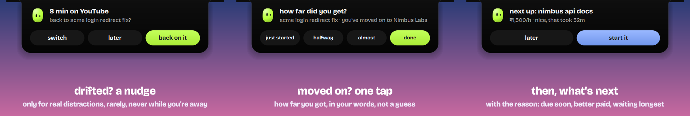</p>

### ✦ You can see it think

The model runs on your laptop, so you should be able to tell when it's working, what it wrote and why. One mark, a little sparkle in lime, blue and pink, sits on everything the model wrote and on nothing else.

- **A live mind, not a status badge.** The header pill says what the model is doing while it does it (*"reading 5 min of your windows…"*), then what it did and how long that took on your GPU. The island's edge lights up in the same colours for as long as it thinks.
- **The day, in its own words.** Above the numbers, the model writes how your day went in a sentence or two, from your receipts: *"you nailed the auth logic and fixed the oauth redirect for acme-website. then you spent time on chai & co…"*. It's rewritten only when the day changes, and when the model is off there's no sentence at all, never a canned one.
- **New lines write themselves in.** When a new slot of your time gets labelled, the card appears on the page on its own and its line writes in, left to right. Nothing you typed ever animates like that, so you can always tell whose words are whose: a card says *gemma* until you rewrite it, then *your words*.
- **Reasons, with receipts.** *why?* now starts with the reason (*"gemma read these windows and filed them under Chai & Co. 92% of the time mentions your hints: shopify, chaico"*), and the matching words are marked in the windows below.
- **It learns from your fixes.** Move a session to the right client and the model picks the word that should have told it (*"masala-landing"*). Plain code checks that word is really in those windows, isn't generic, and isn't already someone else's hint, then lowkey says *"learned: masala-landing means Chai & Co from now on"*, with undo. When nothing qualifies, it learns nothing rather than guess.

### 🎛️ Every control, explained

**Hover anything on the island and it tells you what it does,** in the line under the client name.

| Control | Where | What it does |
|---|---|---|
| **the lip** | island, resting | Hover to open the pill; keep hovering (or click) to open the full card. Double-click pins it open; double-click again tucks it away. |
| **the creature** | island | Your current client, as a blob in their colour. Click it for a one-liner about your day; click again for the next. |
| 🌙 **go dark** | island | Pauses tracking. Nothing is saved until you resume, so the AI never sees those minutes and they can't reach an invoice. The island turns into a night sky. Not remembered after a restart. |
| ☀️ **resume** | island, while dark | Back on the clock from this moment. |
| ↗ **open lowkey** | island, open card | The one filled button: opens the dashboard. |
| ••• **more** | island, open card | Slides the buttons over to the rarer actions below. Turns into ✕ to slide back. |
| 🎮 **not work** | island, behind ••• | Marks the current session as a side quest (personal), so it stays off the invoice. Undo stays on offer for 5 s; the shrinking underline is the countdown. Dimmed when there's nothing to move (already personal, or gone dark); hover it to see why. |
| 📌 **pin** | island, behind ••• | Keeps the pill out instead of tucking it away. Click again to unpin. |
| ⚙️ **settings** | island, behind ••• | Which edge it lives on, below or over the taskbar, tucked or a pill at rest, and how many minutes the model reads at a time (**reads every** 5, 10 or 15 min; 5 by default). A new length applies today if nothing today is reviewed yet, otherwise from tomorrow, so your approvals never lose their sessions. Hover an option for an animated preview of exactly where it goes; click to apply. The ‹ goes back. |
| **quit lowkey** | island settings | Stops tracking and closes the island (it tucks away first). `Ctrl+C` in the terminal works too. Only one lowkey runs at a time: a second copy says so and exits. |
| ◔ **today** | island, open card | Billable time today. The ring fills up towards your daily goal (`daily_goal_h`). Click to open the dashboard. |
| ₹ **earned today** | island, open card | Earned today at your client rates; it glows when it ticks up. Click to make the invoice. |
| ● **to review** | island, open card | Sessions you haven't approved yet. Its dot pulses while something waits; click to review them. |
| **what are you working on?** | dashboard, top (nothing on) | The headline is the question: type the answer. Chips show what lowkey understood; `Enter` starts it, `Shift+Enter` saves it for later. `I` jumps here. |
| **then…** | dashboard, next up (something on) | Opens in place to line up what's after this one. `Enter` adds it to next up, in its place by deadline and rate. |
| **done · set aside** | dashboard, now | Finish the current intention, or put it back in line and say how far you got. |
| **next up** | dashboard, now | Your queue, in order, each with its reason. Click one to start it (it grows into "now"); × drops it. |
| **back on it · later · switch** | island, after a nudge | Back to what you said you'd do, snooze it, or say you've moved on. |
| **just started · halfway · almost · done** | island, when you move on | How far you got, in one tap. Then it suggests what's next. |
| **bill it / nah** | dashboard card | The two buttons on a session waiting for review: approve it for the invoice, or leave it off. Either way it settles into a sticker, flies home to the island, and **undo** stays on offer. |
| **the client sticker** | dashboard card | Click it to move the session to another client. |
| **the line itself** | dashboard card | Click it to edit the invoice line (`Enter` saves, `Esc` cancels). |
| **why?** | dashboard card | The reason first (who filed it, and which of your hints matched), then the exact windows behind the line, with the matching words marked. |
| ✦ **the mind pill** | dashboard header | What the local model is doing right now, then what it did and how long it took. Grey when the model is off. |
| **log missed time** | dashboard, your day | The gaps in your day are time lowkey didn't see. Click one (or drag across part of it, then pull either end), say what it was, `Enter`. Chips show the client and what it's worth; a time or length in your words wins. `L` picks your latest gap. Logged blocks are dotted, their cards say "added by you", and both can be undone. |
| 👥 **your clients** | dashboard header | Add, rename, recolour and re-rate clients, edit their hints, and set your name, email, currency and daily goal. Saves as you go; renaming a client carries its history (labels, edits, receipts, intentions) to the new name. |
| **off the clock** | dashboard | Your personal time by kind (watching, gaming, social, messaging, music…) and by app (YouTube, Valorant, WhatsApp…). Point at a kind to lift its arc in the ring; click a row for its apps; click a day in the week strip to go there. |
| **all · to review · billed · side quests** | dashboard | Filters, with counts. The cards re-flow on springs. |
| **vibe check queue** | dashboard | Click to start reviewing: it filters to what's waiting and focuses the first one. Hover it for the keyboard shortcuts. |
| **‹ day ›** | dashboard header | Change day. The page slides the way you went. |
| ✦ **wrapped** · ⚙ **settings** · ◐ **theme** | dashboard header | Icon buttons; hover one and it says what it does. The theme follows your system (dark when your OS is dark) until you pick one; pick your system's own theme again and it's back on automatic. |
| **send the bill** | dashboard header | The one filled button: a receipt-style invoice per client from approved sessions → PDF or CSV. |
| **undo** | snackbar | Every change shows what happened with an undo while the line runs out (5 s). `Ctrl`/`⌘` + `Z` works too. |

**Keyboard in the dashboard:** `I` what are you working on · `L` log missed time · `C` clients · `J`/`K` move · `Y` bill it · `N` nah · `E` edit · `←`/`→` day · `B` bill · `W` wrapped · `S` settings · `Ctrl+Z` undo · `Esc` close.

### 🧾 The dashboard

Your day as colour blocks, one card per work session, each with an invoice line written by the model. Light or dark follows your system.

<p align="center">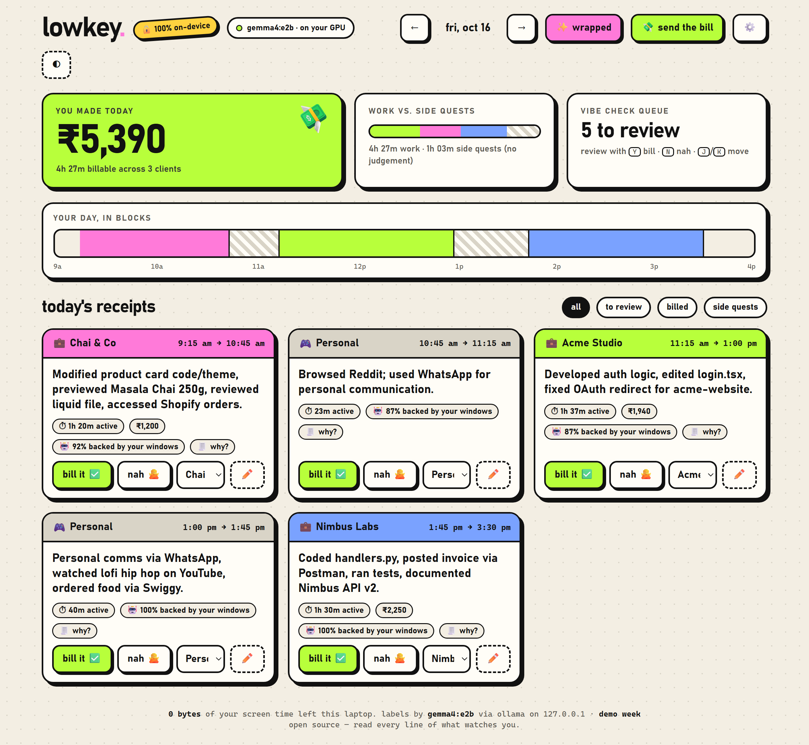</p>

- **Review like a feed:** each card is just its line, a quiet details row and two buttons. The client sticker is the client picker; click the line to edit it.
- **Keyboard:** `J`/`K` move · `Y` bill · `N` nah · `E` edit · `←`/`→` change day · `B` bill · `W` wrapped · `S` settings · `Ctrl+Z` undo.
- **why?** unfolds the exact windows behind every line. If a client ever asks what they paid for, you have receipts.
- **"% backed"** is computed by plain code, not by the model: the share of the session's time whose window titles match that client. A low score shows up as *"check me"*.
- **Off the clock.** The time the model called personal, broken down the way Screen Time would: watching, gaming, social, messaging, music, shopping & food, reading & learning. Each source (Netflix, YouTube, Valorant, Swiggy…) is categorized once, by plain hints where they're obvious and by the local model where they aren't, and remembered. A client's window inside a personal slot still counts as work, and a session you move to a client stops counting here. Beside it, the week: a bar a day, your daily average dashed across, and one plain line on how the day compares (*"11m less than your daily average"*). No scores, no scolding.
- **Log what it couldn't see, where it happened.** A phone call, an offline meeting, work on paper: they show up as gaps in your day. Click the gap, say *"call with acme"*, and it fills in, billed like any other session. No client named? The local model picks one, the same way it does for intentions.

<p align="center">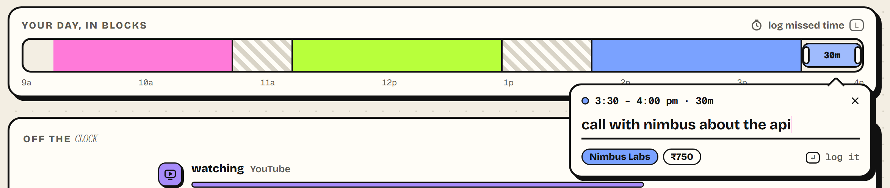</p>
- **Your clients, in the dashboard.** No more editing JSON: name, rate, colour and hints, saved as you go.

<p align="center">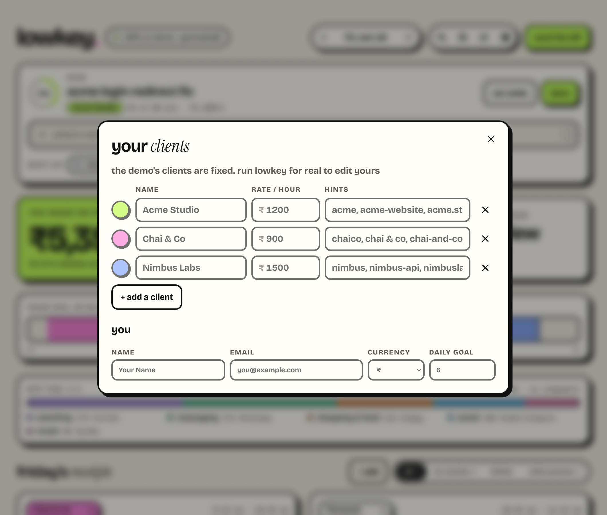</p>

- **It moves like it means it.** Real spring curves everywhere; numbers roll digit by digit; "send the bill" grows into its sheet and shrinks back into the button; changing day slides the page; filters re-flow the cards; the theme switch spreads out from the button as a circle. All of it switches off when your OS asks for reduced motion.

#### Changes fly home

Bill a session and the button settles into a ticked sticker, then a little capsule lifts off it and flies to your island: out of the page, across your desktop on the same arc, and under the island's edge. The island gulps, flashes in the client's colour, says what happened, and its numbers update. The page draws the capsule inside the browser; the island draws the very same capsule, on the same curve and clock, everywhere outside it, so a small or off-to-the-side window hands it over at its edge without a seam.

<p align="center">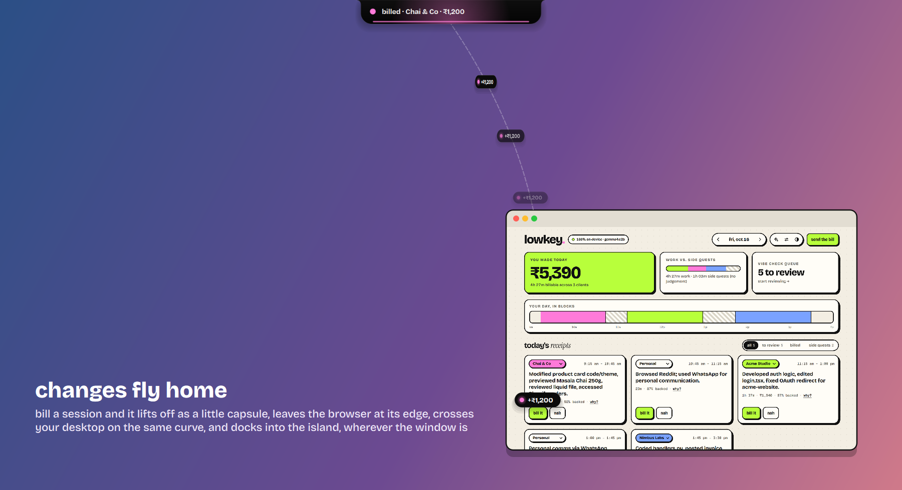</p>

### Send the bill · Wrapped

<table>
<tr>
<td width="50%">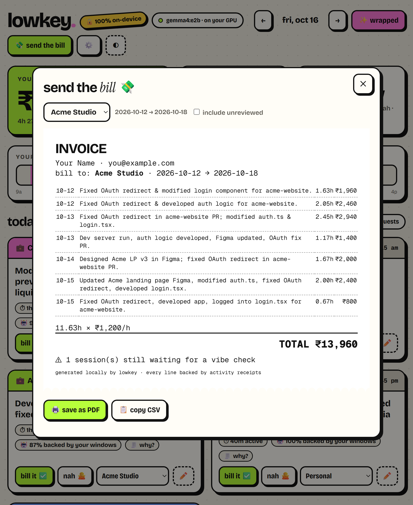</td>
<td width="50%">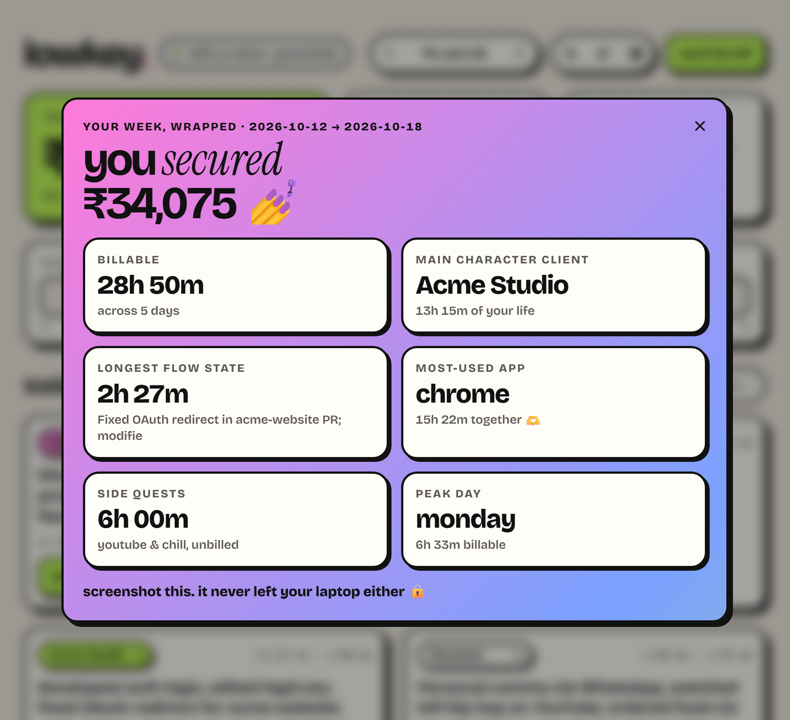</td>
</tr>
<tr>
<td>A receipt-style invoice per client from the sessions you approved. Save as PDF or copy as CSV.</td>
<td>Your week as a shareable card: main character client, longest flow state, side quests.</td>
</tr>
</table>

### ⚙️ Island settings

Pick the **edge** (top, bottom, left, right), what happens when the island **shares an edge with your taskbar** (sit over it like a real notch, or hang below it), and whether it rests as a **tucked-away lip** or an **always-visible pill**. The same three rows live in the dashboard and inside the island itself. Hover an option and one live preview of *your* screen acts it out: a new edge tucks into the old one and blooms out of the new.

<p align="center">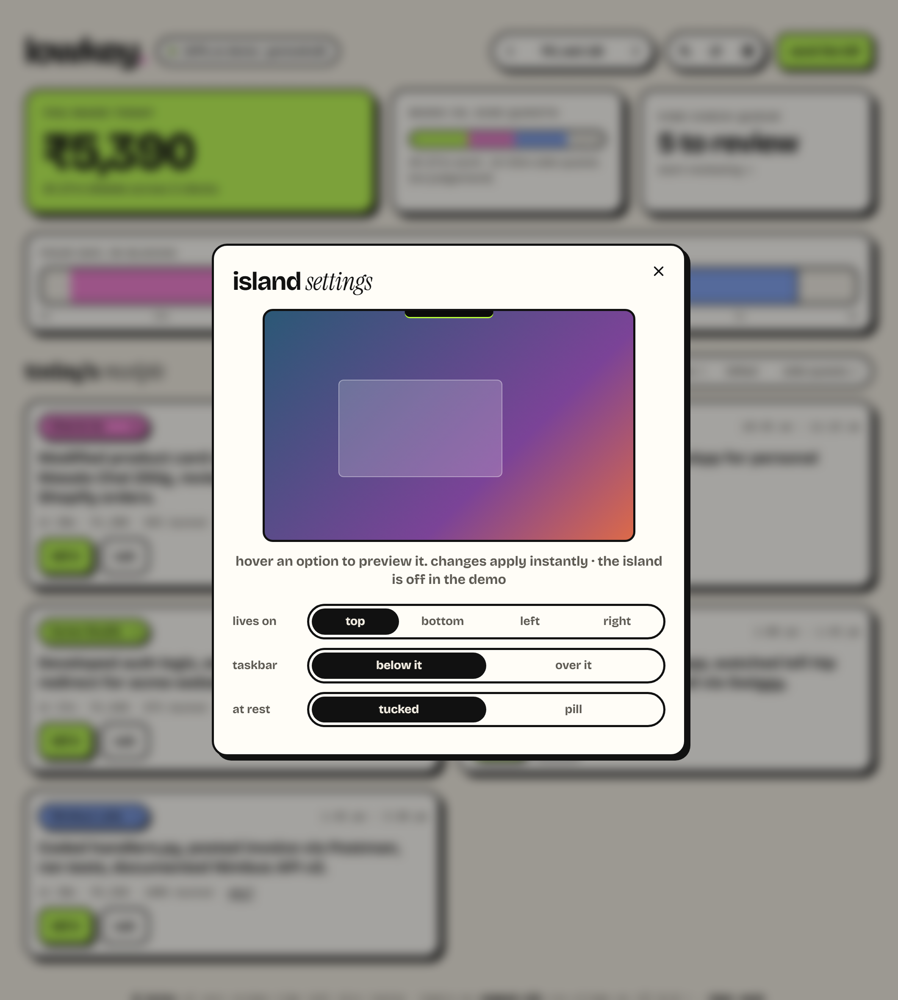</p>

## 🧠 How it works

<p align="center">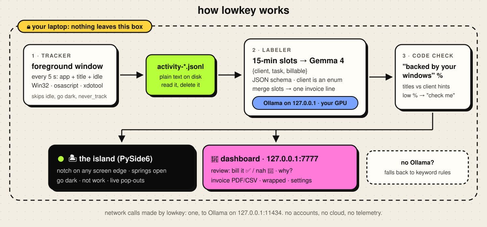</p>

1. **Tracker:** every 5 seconds, the foreground app and window title are appended to `data/activity-YYYY-MM-DD.jsonl`. Nothing is written when you're idle, when you've hit *go dark*, or for apps in `never_track`.
2. **Labeler:** activity is cut into slots, 5 minutes by default (**reads every** in settings: 5, 10 or 15). Each slot goes to **Gemma 4 E2B** through Ollama, which returns `{client, task, billable}`.
   - The output is constrained by a JSON schema, and `client` is an enum of *your* clients, so the model can't invent one.
   - Consecutive slots for the same client merge into a session, and a second pass writes one clean invoice line.
3. **Code check:** plain code scores how well window titles back each session. You review, and only approved sessions reach an invoice.

If Ollama isn't running, lowkey falls back to keyword rules and says so in the UI. Deep dive: [docs/how-it-works.md](docs/how-it-works.md).

## 🔒 Privacy

- **Local only.** The dashboard and API bind to `127.0.0.1`. The page loads no external fonts, scripts or images.
- **Only its own pages get an answer.** The API refuses any request whose `Host` isn't this machine (so a website can't use DNS rebinding to read your activity) and any POST from another site's origin or that isn't JSON (so a page you visit can't quietly edit your sessions).
- **One network call.** lowkey talks only to Ollama on `127.0.0.1:11434`. No accounts, no cloud, no telemetry.
- **Plain files.** Your activity is plain JSONL in `data/`. Open it, edit it, delete it.
- **You choose what's never recorded.** `never_track` skips apps entirely (password managers, private browsing by default), and **go dark** pauses everything with one click.
- **Your config stays out of git.** `clients.json`, `settings.json` and `data/` are gitignored.

More in [docs/privacy.md](docs/privacy.md).

## 💻 Platform support

| | Windows 10/11 | macOS | Linux |
|---|:---:|:---:|:---:|
| Tracker | ✅ Win32 via ctypes | ✅ `osascript` + `ioreg` | ⚠️ X11 only (`xdotool`, `xprintidle`) |
| Island | ✅ | ✅ (sits below the menu bar) | ✅ |
| Dashboard | ✅ | ✅ | ✅ |

Daily use is on Windows 11. The macOS and Linux trackers are covered by tests with recorded command output, but haven't run on real hardware yet. Reports are welcome.

## 📊 Numbers so far

| Test | Gemma 4 E2B (local) | Keyword rules |
|---|:---:|:---:|
| Right client per 15-min slot, **synthetic** demo week (155 slots) | 152 / 155 (98.1%) | 150 / 155 (96.8%) |
| Minutes billed to the right client, same week, by slot length | 5 min: **94.6%** · 10 min: 91.7% · 15 min: 91.7% | — |
| Label latency, RTX 4050 Laptop (6 GB), thinking off | ~0.3–0.6 s | instant |
| Same call with Gemma 4's thinking on | ~9.5 s | — |

Shorter slots give the model less to go on per label (it picks the slot's main client 95.7% of the time at 5 minutes, 98.1% at 15), but they sweep far less of your time into the wrong client, so more of the money lands right. That's why 5 minutes is the default: under half a second of GPU per label, 12 slots an hour.

The synthetic week is deliberately easy for keywords, since its window titles contain client names. The model earns its place on real days, where titles don't name the client, and in writing invoice lines, which rules can't do.

### Re-run the numbers

```bash
python -m lowkey.eval
```

It labels every slot of the demo week at 5, 10 and 15 minutes, with the model and with the keyword rules, and prints a table like the one above (slots, right client per slot, minutes billed right, ms per label). The answer key is the client hints: a slot's client is whoever owns most of its seconds. It calls the model directly, skips the cache and writes nothing. Without Ollama it prints the rules rows and says the model rows were skipped. Latency depends on your hardware.

## ❓ FAQ

<details><summary><b>Does it record my screen?</b></summary>

No screenshots, no keystrokes, no audio. Only the foreground app name and window title, every 5 seconds, into a text file on your disk.
</details>

<details><summary><b>Do I need a GPU?</b></summary>

No. Without one, Gemma 4 E2B runs on CPU via Ollama, just slower. Labels are cached, so each slot is labelled once. Any Ollama model with structured outputs works: `LOWKEY_MODEL=qwen3:4b python -m lowkey`.
</details>

<details><summary><b>What if the model gets a session wrong?</b></summary>

Nothing is billed until you approve it. Change the client from the card's dropdown, edit the line, or press `N`. The "backed by your windows" score points you to the sessions worth checking.
</details>

<details><summary><b>My taskbar is at the top. Will the island cover it?</b></summary>

Your choice. In settings, "sit on the screen edge" floats the island over the taskbar like a notch; "hang below it" attaches it underneath. Bottom-taskbar users aren't affected either way.
</details>

## 🛠️ Development

```bash
python tests/test_lowkey.py       # or: python -m pytest tests
python -m lowkey --demo           # UI work without tracking
```

```
lowkey/
├── __main__.py      entry point: python -m lowkey
├── config.py        paths, clients, settings, shared live state
├── tracker.py       foreground window on Windows / macOS / Linux
├── labeler.py       slots → Gemma → sessions → invoice lines
├── server.py        local dashboard + JSON API
├── island.py        the notch (PySide6, hand-painted)
├── mascot.py        the island's creature: shapes, eyes, moods, one-liners
├── jelly.py         jelly icons: moon, sun, gamepad, live clock, flipping coin, self-drawing tick
└── web/index.html   the dashboard (no build step, no CDN)
demo/                a synthetic week for --demo
docs/                guides and images
tests/               core logic checks
```

See [CONTRIBUTING.md](CONTRIBUTING.md).

## Credits

- Fonts, bundled so the app makes no web-font requests, all under the SIL Open Font License (licences in [`lowkey/web/fonts/`](lowkey/web/fonts)):
  - [Bricolage Grotesque](https://github.com/ateliertriay/bricolage) for the UI
  - [Instrument Serif](https://github.com/Instrument/instrument-serif) for the italic accents
  - [Geist Mono](https://github.com/vercel/geist-font) for numbers
- Icons: lowkey's own "jelly" icons ([`lowkey/jelly.py`](lowkey/jelly.py)), drawn with the same light as the creatures.
- Creature style inspired by the procedural avatars of [Bible Strong Avatar Lab](https://github.com/smontlouis/bible-strong-avatar-lab). lowkey's creatures are drawn by its own QPainter renderer; no code or art is taken from that project.
- Local inference: [Ollama](https://ollama.com) running Google's open-weight [Gemma 4](https://ai.google.dev/gemma).

## License

[MIT](LICENSE). Use it, fork it, ship it.
